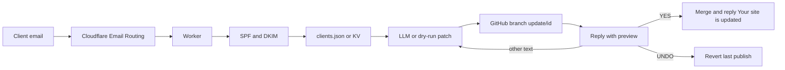

# Update automation

Email is the only channel that is on. Google Voice and Twilio code paths exist and default to off (`CHANNEL_GOOGLE_VOICE=false`, `CHANNEL_TWILIO=false`).

## Message flow

1. Mail arrives at the address on the client's plan. Cloudflare Email Routing sends it to the Email Worker. A Postmark inbound webhook can hit `POST /webhooks/email` instead.
2. The worker reads `Authentication-Results`. Both SPF and DKIM must pass. If they do not, nothing is changed.
3. The sender's address must match `clients.json` (or the KV/D1 copy). Unknown senders get a short reply and no edit.
4. Clinic clients: if the text looks like patient information, the worker refuses it, does not store the body, and logs only that a refusal happened.
5. Risky asks (page deletion, privacy or terms text, a redesign, a cure claim) go to `OWNER_EMAIL` and are not published.
6. Otherwise the worker asks the LLM for a patch, commits branch `update/<client id>`, and replies with a one-sentence summary, a preview link, and "Reply YES to publish or tell me what to change".
7. `YES` merges that branch and replies "Your site is updated". Any other reply revises the same branch and sends a new preview. `UNDO` reverts the last publish.

Pending state lives in KV under `pending:<client id>`. A month counter lives under `usage:<client id>:YYYY-MM`.

## Sender verification

- Email: `spf=pass` and `dkim=pass` in `Authentication-Results`, or Postmark `SPF` / `DKIM` values of `pass`.
- Google Voice, only if you later set `CHANNEL_GOOGLE_VOICE=true`: the From address is parsed as `<gv number>.<sender number>.<id>@txt.voice.google.com`. The footer is stripped at the first of `YOUR ACCOUNT`, `To respond, reply to this email`, `https://voice.google.com`, or a `--` line. The reply is emailed back to that same address so Google Voice can deliver it as a text. This format is unofficial and can change. Google Voice is a personal product. Photos and MMS often do not forward. Keep the flag false until you have checked a real sample from your own account.
- Twilio, only if `CHANNEL_TWILIO=true`: `X-Twilio-Signature` is HMAC-SHA1 of the URL plus sorted form fields. There is no ongoing free SMS tier (trial credit only). See [Twilio SMS pricing](https://www.twilio.com/en-us/sms/pricing/us). Leave it off.

## Data model

`clients.json` fields: `id`, `name`, `plan`, `active`, `clinic`, `emails`, `phones`, `repo`, `sitePath`, `siteUrl`, `monthlyPublishCap`.

The sample row is the fictional Merrin & Quill clinic at `/clinics/sample/`. It starts inactive until a test payment marks it active.

## Approval states

| State | Meaning |
| --- | --- |
| idle | No preview waiting |
| awaiting_approval | Branch and preview exist |
| publish | YES merged the branch |
| undo | Last publish reverted |

## Security and privacy

- Allowed senders only. Approval before every publish.
- Care plans use a monthly publish cap (default 100) so a loop cannot ship unlimited commits. The marketing pages describe small edits; this cap is the operational ceiling.
- Clinic mail that matches patient-identifier patterns is dropped. The log stores `phi_refused` and the client id, not the body.
- Secrets stay in `wrangler secret`. The repo has placeholders only.
- Dry run (`DRY_RUN=true`) does not call GitHub or an LLM.

## Failure handling

- Bad signature, failed SPF/DKIM, unknown sender, inactive plan, PHI, risky text, or the monthly cap: no commit. The sender gets a plain sentence.
- LLM or GitHub errors: no publish. The owner email gets the error class, not a dumped patient note.
- A YES with no preview replies that there is nothing waiting.

## Setup

1. `npx wrangler kv namespace create STATE` and replace `TODO_KV_NAMESPACE_ID`.
2. `npx wrangler d1 create siteowned`, put the id in `wrangler.toml`, then `npx wrangler d1 execute siteowned --file=schema.sql`.
3. Route the client update address in Cloudflare Email Routing to this worker.
4. `wrangler secret put GITHUB_TOKEN` with contents permission on the site repo. Optional: `GEMINI_API_KEY`. No key means dry-run patches.
5. Keep `CHANNEL_GOOGLE_VOICE` and `CHANNEL_TWILIO` false.
6. `npm test` then `npx wrangler dev` and POST `payloads/email-known.json` to `/webhooks/email`.

## Cost estimates

These are estimates from public pricing pages, not a bill.

| Piece | Estimate | Source |
| --- | --- | --- |
| Workers Free | 100,000 requests/day, 10 ms CPU per invocation, $0 | [Workers pricing](https://developers.cloudflare.com/workers/platform/pricing/) |
| KV Free | 100,000 reads/day, 1,000 writes/day | same page |
| D1 Free | 5 million rows read/day, 100,000 rows written/day, 5 GB, 10 databases | same page |
| Email Routing inbound | No monthly plan fee for receiving and routing | [Email Routing](https://developers.cloudflare.com/email-routing/get-started/) |
| Gemini | Free tier with published rate limits when you have an API key. Dry-run is $0 with no key. | [Gemini API pricing](https://ai.google.dev/gemini-api/docs/pricing) |
| Stripe | $0 monthly on standard pricing. Per successful charge when you go live. | [stripe.com/pricing](https://stripe.com/pricing) |
| Twilio SMS | Not free after trial credit. Off by default. | [Twilio SMS pricing](https://www.twilio.com/en-us/sms/pricing/us) |
| Domain | About $12 a year, paid to a registrar, not to SiteOwned | The offer on the public site |

A handful of email edits a month for one client stays inside the free Worker, KV, and D1 allowances. The cost that is not optional once you charge real cards is Stripe's per-transaction fee. SMS is optional and should stay off.
